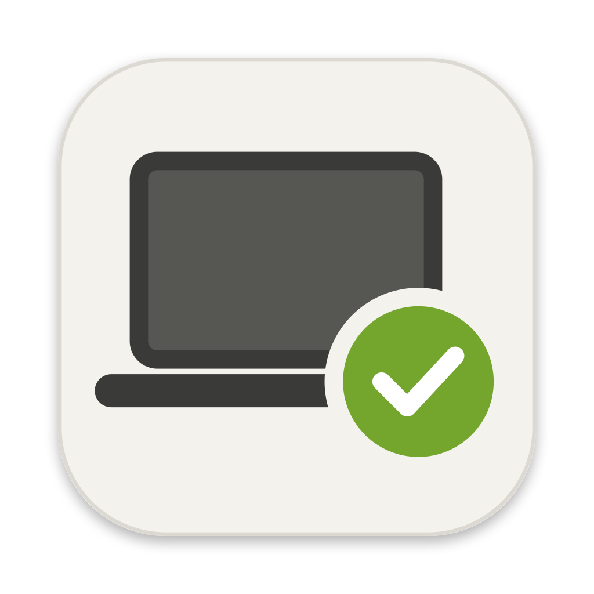

<p align="center">
  
</p>

<h1 align="center">Mac Check</h1>

<p align="center">
  Inspect a used Apple Silicon Mac before you pay for it.<br>
  <a href="https://github.com/anoobsuresh0/Mac-Test/releases/latest/download/MacCheck.dmg"><b>Download the latest DMG</b></a>
  · <a href="https://maccheck.anoob.work">Website</a>
  · <a href="https://github.com/anoobsuresh0/Mac-Test/releases">All releases</a>
</p>

---

Mac Check is a small, free macOS app you run **on the Mac you're thinking of buying**. In about ten seconds it checks for the things a seller might not mention, explains every result in plain English, and then guides you through the hands-on tests only you can do.

It only reads information. It never changes anything on the Mac.

## What it checks

**Automatically (Step 1)**

| Area | What it looks at |
| --- | --- |
| Ownership locks | Activation Lock, company or school ownership (DEP), remote management (MDM) |
| Security and tampering | System Integrity Protection, Gatekeeper, startup security, third-party drivers, remote-control or tracking tools, remote login and screen sharing, hidden or extra user accounts |
| Crash history | Kernel panics, which usually point to failing memory, SSD or logic board |
| Battery and charger | Condition, charge cycles, real capacity against the original, genuine Apple charger, whether it's charging |
| Storage | SSD health, wear %, data written, power-on hours, data errors, spare capacity |
| Wireless | Wi-Fi chip and how many networks it can see, Bluetooth chip |
| Other parts | Display, camera, microphone, Touch ID |

**Admin checks** (optional, the Mac's password is typed into macOS's own dialog) add Apple's organisation-ownership records, every installed profile, and the startup security level.

**Hands-on tests (Step 2)**

- **Screen, keyboard, speakers and trackpad:** a Safari page with full-screen colours for dead pixels, a keyboard map that lights up each key, left/right speaker tones, a bass sweep, trackpad corners and a Force Touch meter.
- **Stress test:** three minutes on every core, watching heat and slowdown.
- **USB-C ports:** each port turns green when it detects a device.
- **Bluetooth scan:** finds nearby devices to prove the antenna works.

Steps 3 and 4 in the app list the manual checks (parts history, warranty, Apple Diagnostics, physical condition) and how to watch the seller erase the Mac before you pay.

## Requirements

- An Apple Silicon Mac (M1 or later). Intel Macs aren't supported.
- macOS 12 Monterey or later.

## Installing

1. Download [`MacCheck.dmg`](https://github.com/anoobsuresh0/Mac-Test/releases/latest/download/MacCheck.dmg), open it and drag **Mac Check** into **Applications**.
2. Open it. macOS says *"Apple could not verify Mac Check"*, because the app isn't notarised by Apple. Click **Done**.
3. Open **System Settings › Privacy & Security**, scroll down and click **Open Anyway**. It opens normally from then on.

Copying the DMG from a USB stick formatted as ExFAT or FAT32 usually skips step 2, which is handy on a seller's Mac.

Without the app, the checks also run from Terminal:

```bash
bash mac-check.sh
```

## Building from source

You only need Apple's Command Line Tools (`xcode-select --install`), not full Xcode.

```bash
./build.sh
```

This compiles the app and the SSD helper, signs the app for local use, and writes `dist/MacCheck.app` and `dist/MacCheck.dmg`.

To change the icon, edit `make-icon.swift`, then:

```bash
swift make-icon.swift
iconutil -c icns AppIcon.iconset -o AppIcon.icns && rm -rf AppIcon.iconset
./build.sh
```

### Project layout

| File | Purpose |
| --- | --- |
| `MacCheck.swift` | The app window (SwiftUI): runs the checks script, shows results, hosts the stress, port and Bluetooth tests |
| `mac-check.sh` | Every automatic check. Its output format is parsed by the app; also works on its own in Terminal |
| `ssdwear.c` | Reads the SSD's health log through Apple's built-in NVMe interface |
| `test-page.html` | The screen, keyboard, speaker and trackpad test page, opened in Safari |
| `make-icon.swift` | Draws the app icon |
| `build.sh` | Builds the app bundle and DMG |
| `.github/workflows/release.yml` | Builds and publishes a release when a version tag is pushed |
| `site/` | The download website, deployed on Vercel |

## Releasing a new version

Commit your changes, then push a version tag:

```bash
git tag v1.2
git push origin v1.2
```

GitHub Actions builds the DMG on an Apple Silicon runner, stamps the version from the tag into the app, and publishes it as a GitHub Release with auto-generated notes. The asset is always named `MacCheck.dmg`, so this link always serves the newest version:

```
https://github.com/anoobsuresh0/Mac-Test/releases/latest/download/MacCheck.dmg
```

## Deploying the website

The site in `site/` is plain HTML with no build step. It reads the latest release's version and size from GitHub, so it never needs editing for a new release.

**First deploy on Vercel**

1. On [vercel.com](https://vercel.com), choose **Add New › Project** and import `anoobsuresh0/Mac-Test`.
2. Set **Root Directory** to `site`.
3. Leave **Framework Preset** as **Other** with no build command, then click **Deploy**.

After that, every push to `main` redeploys automatically.

**Custom domain (`maccheck.anoob.work` on Cloudflare)**

1. In Cloudflare, open **anoob.work › DNS › Records** and add:

   | Type | Name | Target | Proxy status |
   | --- | --- | --- | --- |
   | CNAME | `maccheck` | `cname.vercel-dns.com` | DNS only (grey cloud) |

2. In Vercel, open **Settings › Domains** and add `maccheck.anoob.work`. If Vercel shows a different target, update the Cloudflare record to match.
3. Wait for **Valid Configuration**. Vercel issues the HTTPS certificate itself.

Keep the record on **DNS only**. Proxying through Cloudflare stops Vercel from issuing the certificate.

`site/vercel.json` also adds a short link, `/download`, that redirects to the latest DMG.

**Preview locally**

```bash
python3 -m http.server 4321 --directory site
```

Then open <http://localhost:4321>.

## Limitations

- **Warranty:** Apple has no public warranty API and its coverage page uses a CAPTCHA, so the app copies the serial and opens the page for you to paste into.
- **No guarantees:** a clean report catches the common deal-breakers and hidden faults, but it can't guarantee a Mac is perfect. Run Apple Diagnostics (hold the power button, then press ⌘D) as well.
- **Not notarised:** removing the "could not verify" prompt needs a paid Apple Developer account to sign and notarise the app.

---

Mac Check is an independent project and isn't affiliated with or endorsed by Apple. Mac, MacBook and Apple Silicon are trademarks of Apple Inc.
